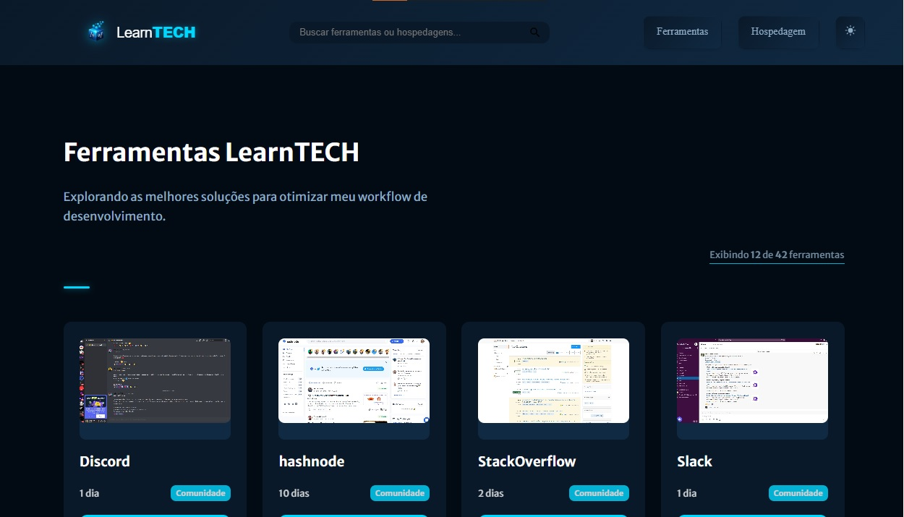
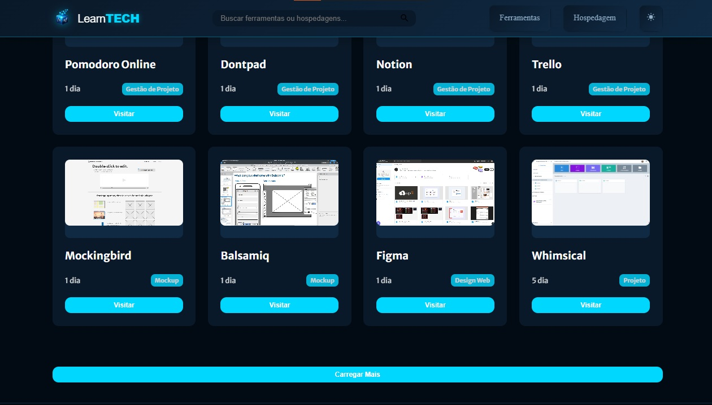
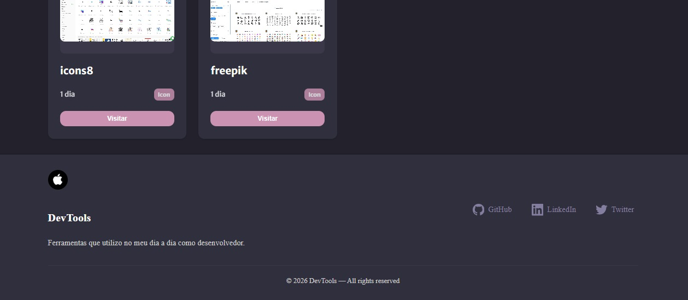
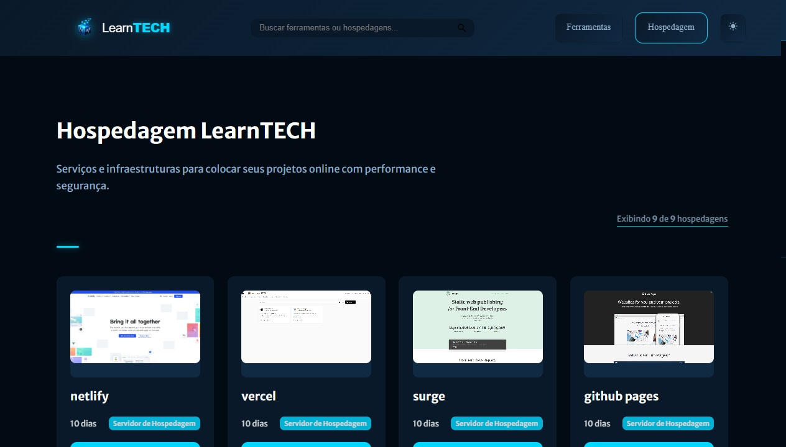
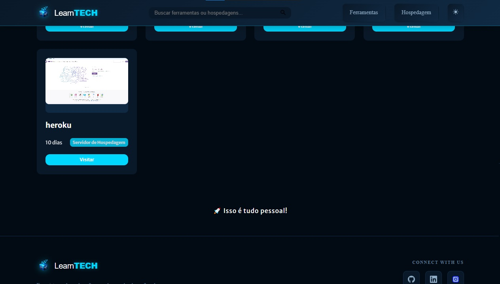
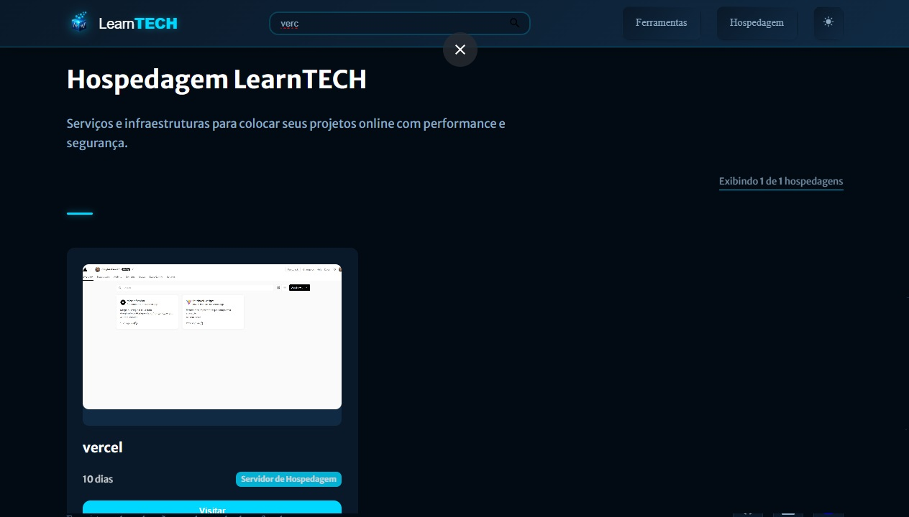
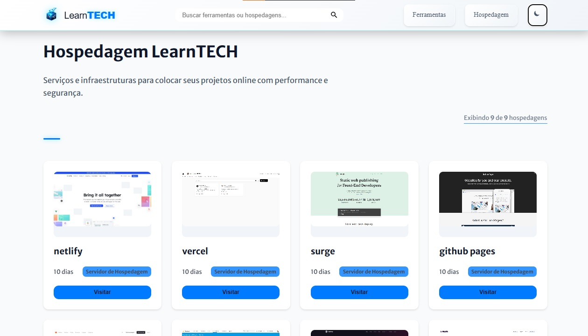

<h1 align="center">🧰 Tools</h1>

<p align="center">
  <strong>O catálogo de ferramentas do ecossistema LearnTECH</strong><br />
  91 ferramentas · 12 hospedagens · 14 categorias
</p>

> **Vai evoluir o projeto ou trouxe arquivos novos?** Comece por [`docs/COMO-EVOLUIR.md`](docs/COMO-EVOLUIR.md): onde fica cada coisa, o que é gerado pela API, comandos e a checklist de estabilidade.

<p align="center">
  
  
  
  
</p>

---

## 📍 Estado do projeto (06/11/2026)

- **Onde está:** Em produção no GitHub Pages. CI verde com lint, formato, 9 testes e verificação estática.
- **O que fizemos na rodada de MVP (03 a 05/11):** Resposta tardia da API aproveitada, SEO do detalhe com canonical, abas por teclado, "Tentar novamente" no detalhe e o lote 4 de conteúdo.
- **O que queremos fazer:** [#55](https://github.com/douglasabnovato/tools/issues/55), [#60](https://github.com/douglasabnovato/tools/issues/60), [#58](https://github.com/douglasabnovato/tools/issues/58), [#59](https://github.com/douglasabnovato/tools/issues/59), [#56](https://github.com/douglasabnovato/tools/issues/56), [#57](https://github.com/douglasabnovato/tools/issues/57) (miniaturas WebP, contraste, Lighthouse, 404 e CSP, filtro por cobrança e medição). Todas com o label `proximos-passos` e critérios de entrega.

A linha do tempo completa, os números e a ordem sugerida estão em [`docs/ESTADO-DO-PROJETO.md`](docs/ESTADO-DO-PROJETO.md).

## 🧭 Sobre

Reúne, num lugar só, os serviços que eu realmente usei em projetos reais —
atuando como desenvolvedor e como product manager. Cada item entrou na lista
porque resolveu um problema concreto, não porque aparece em ranking de blog.

A proposta é direta: quando alguém precisa de uma ferramenta para uma tarefa
específica — prototipar uma tela, testar uma API, medir a performance de uma
página, escolher uma paleta, colocar o projeto no ar — a resposta já está
catalogada, com o que ela faz, a categoria e o modelo de cobrança.

**Para quem:** pessoas desenvolvedoras, product managers, designers e demais
profissionais de tecnologia que perdem tempo procurando a ferramenta certa.

**O que não é:** um diretório exaustivo. É uma seleção.

---

## 📌 Informações úteis

| | |
| --- | --- |
| **Catálogo** | 91 ferramentas em 14 categorias + 12 hospedagens em 3 (contagem da cópia de 05/11/2026) |
| **Stack** | HTML5, CSS3 e JavaScript ES6 — sem framework, sem build, zero dependência em produção (o `package.json` só traz eslint e prettier) |
| **Hospedagem** | GitHub Pages (`.nojekyll` na raiz) |
| **Tema** | Claro e escuro, seguindo o sistema na primeira visita e salvando a escolha |
| **Externo** | API learntech-content (dados, `/media/` e o script de identificação, que usa Cloudflare Turnstile), Google Fonts e o serviço de favicons do Google em parte das miniaturas — os ícones da interface são SVG embutidos |

### ▶️ Como rodar localmente

O projeto usa **módulos ES6**. Abrir o `index.html` com duplo clique **não
funciona** — o navegador bloqueia módulos carregados via `file://`. É preciso
servir por HTTP:

```bash
# com Node
npx serve .

# ou com Python
python -m http.server 3000
```

Depois abra `http://localhost:3000`.

### ➕ Como adicionar um item ao catálogo

Os dados **não são editados neste repositório**. A fonte é a API
[learntech-content](https://github.com/douglasabnovato/learntech-content):

1. Edite `content/tools/ferramentas.json` (ou `content/tools/hospedagens.json`)
   no repositório learntech-content
2. Rode `npm run copias` lá: ele regenera as cópias de reserva deste site,
   `data/tools.js` e `data/host.js`
3. Faça o commit das cópias aqui

**Não edite `data/tools.js` nem `data/host.js` à mão** — a próxima geração
sobrescreve. Elas também ficam fora do prettier (`.prettierignore`).

O site busca os dados na API e usa as cópias só quando a API falha ou demora
mais de 1,5 s; se a resposta chegar depois, ela substitui a cópia na tela sem
recarregar. Só os dados da API trazem `slug` e `detalhe` (a página de detalhe).

A categoria **não precisa ser cadastrada em lugar nenhum**: a barra de filtros é
montada a partir dos próprios dados, com a contagem de cada uma.

### ✅ Testes e qualidade

```bash
npm ci
npm test              # node --test
npm run lint          # eslint
npm run format:check  # prettier
```

A CI (`.github/workflows/ci.yml`) roda os três, mais `docs/claudeia/verificar.ps1`.

---

## ✨ O que a interface faz

- **Duas seções** — Ferramentas e Hospedagens, em abas
- **Filtro por categoria** com a contagem de cada uma; clicar de novo desmarca
- **Busca** por nome, descrição, categoria ou modelo de cobrança — ignora acento,
  então "codigo" encontra "Código"
- **Atalho `/`** para focar a busca (fora de campos de texto) e `Esc` para limpar
- **Abas por teclado** — setas, `Home` e `End` trocam entre Ferramentas e Hospedagens
- **URL compartilhável** — `?s=host&c=Aplicação` reabre exatamente aquele recorte
- **Paginação incremental** — 12 iniciais, +12 por clique
- **Carregamento preguiçoso** das imagens via `IntersectionObserver`
- **Tema claro e escuro** respeitando a preferência do sistema na primeira visita
- **Card inteiro é um link** — abre o detalhe na mesma aba ou, sem detalhe, o site
  em nova aba com `rel="noopener noreferrer"`; sempre com nome acessível próprio

### 📄 Página de detalhe

Quando um item vindo da API tem `slug` e `detalhe`, o card abre
`detalhe.html?id=<slug>` na mesma aba (o mesmo endereço do `sitemap.xml`; o formato antigo com `#` continua aceito), em vez do site oficial. Item sem detalhe
continua abrindo o site em nova aba.

- **O que mostra** — miniatura, título, categoria e preço, resumo em destaque,
  parágrafos, galeria (com legenda), vídeo do YouTube em modo `youtube-nocookie`,
  botão "Acessar site oficial", links oficiais, fontes e "Atualizado em dd/mm/aaaa"
- **De onde vem** — só da API (`/v1/tools/ferramentas.json` e
  `/v1/tools/hospedagens.json`; procura nas duas). Os dados locais não têm detalhe
- **Estados** — carregando; item não encontrado; API não configurada ou fora do ar
  ("Os detalhes ficam disponíveis quando a API está ativa", com "Tentar novamente"),
  sempre com link de volta
- **SEO** — `canonical` e `og:url` em `detalhe.html?id=<slug>`, `og:image` absoluto,
  `og:title`/`og:description` do item e description cortada em 160 caracteres
- **Voltar** — retorna ao catálogo com a mesma seção, filtro e busca quando o
  visitante veio dele
- **Segurança** — o DOM é montado com `textContent`; links e imagens só `http(s)`
  (ou `./assets/` para miniatura); caminhos `/media/...` viram URL da API
- **Arquivos** — `detalhe.html`, `js/detalhe.js`, `css/detalhe.css`

Para testar: `http://localhost:3000/detalhe.html?id=<slug>` com `js/config.js`
apontando para a API.

---

## 🗂️ Estrutura de pastas

```text
tools/
├── index.html              estrutura da página, ícones SVG e o <template> do card
├── detalhe.html            página de detalhe de um item (?id=<slug>)
├── main.js                 ponto de entrada: entrega os dados para a aplicação
│
├── data/
│   ├── tools.js            cópia de reserva: 91 ferramentas (gerada pela API)
│   └── host.js             cópia de reserva: 12 hospedagens (gerada pela API)
│
├── js/
│   ├── renderer.js         a aplicação: seção, filtro, busca, paginação, tema, URL
│   ├── detalhe.js          página de detalhe: busca o item na API e monta a tela
│   ├── api.js              cliente da API: tempo limite, /media/ e identificação
│   ├── config.js           endereço da API
│   └── utils.js            debounce, normalização, validação de lista e corte de texto
│
├── css/
│   ├── layout.css          tokens de tema, base tipográfica, grade e filtros
│   ├── header.css          cabeçalho fixo, abas, busca e alternância de tema
│   ├── cards.css           o card do catálogo
│   ├── footer.css          rodapé
│   └── detalhe.css         página de detalhe
│
├── assets/
│   ├── thumb_tools/        miniaturas das ferramentas
│   ├── thumb_host/         miniaturas das hospedagens
│   └── logos/              identidade visual
│
├── public/                 favicons, manifest e a imagem de compartilhamento
├── tests/                  testes com node --test
├── sitemap.xml             gerado pela API (scripts/gerar-sitemaps.mjs)
├── serve.json              mantém ?id= no npx serve (cleanUrls desligado)
└── .github/                capturas de tela usadas neste arquivo
```

### Como os arquivos se conversam

```text
main.js
   ├── js/api.js ────── busca na API (até 1,5 s; resposta tardia entra depois)
   ├── data/tools.js ─┐ cópia de reserva
   ├── data/host.js ──┤
   └── js/renderer.js ┘── monta filtros, grade, busca e paginação
                          └── js/utils.js
```

Não existe camada de componente: o card é um `<template>` no HTML, clonado a cada
renderização. Um item novo no catálogo não cria arquivo nenhum.

---

## 🎨 Design

O tema é definido por variáveis CSS em `css/layout.css`, em dois blocos —
`:root` para o escuro e `[data-theme="light"]` para o claro. **Toda variável
existe nos dois blocos**, o que evita cor de um tema vazando no outro.

| | Escuro | Claro |
| --- | --- | --- |
| Fundo | `#0c0d10` | `#faf9f7` |
| Superfície | `#141519` | `#ffffff` |
| Texto | `#f2f3f5` | `#16181d` |
| Destaque | `#ffb224` | `#b45309` |

Tipografia: **Space Grotesk** nos títulos, **Inter** no texto.

Trocar a cor de destaque do projeto inteiro é mexer em `--accent`, `--accent-soft`
e `--accent-on` — três linhas por tema.

### Princípios adotados

- **Um destaque só.** A cor de destaque marca o que está ativo e o que é gratuito.
  Não há brilho decorativo espalhado pela tela.
- **Superfície sólida.** Sem vidro fosco e sem `backdrop-filter`.
- **O card informa.** Nome, o que a ferramenta faz, categoria e cobrança —
  dá para decidir sem clicar.
- **Movimento com função.** Uma entrada suave quando o resultado muda,
  e nada mais. `prefers-reduced-motion` é respeitado.

---

## 📍 Momento atual

O catálogo está no ar e funcional. A versão 3 reescreveu a interface inteira e
trocou o modelo de dado.

### Concluído

- [x] Catálogo de 91 ferramentas e 12 hospedagens, servido pela API learntech-content
- [x] Campo de descrição em todos os itens
- [x] Campo de modelo de cobrança (Gratuito / Freemium / Pago)
- [x] Categorias reorganizadas — de 16 (oito com um item só) para 12
- [x] Filtro por categoria com contagem
- [x] Busca sem sensibilidade a acento
- [x] Estado na URL, compartilhável
- [x] Card como âncora real, com `noopener` e nome acessível
- [x] Tema claro e escuro sem vazamento de variável
- [x] Ícones SVG embutidos — o CDN de ícones externo saiu
- [x] Imagem de compartilhamento (`og:image`) e caminhos do manifest corrigidos
- [x] Carregamento preguiçoso das imagens
- [x] Página de detalhe com canonical, `og:url` e `og:image` absoluto
- [x] Testes com `node --test`, eslint e prettier na CI

### Em aberto

O que falta virou issue com o label `proximos-passos` e critérios de entrega, na ordem sugerida. O detalhe está em [`docs/ESTADO-DO-PROJETO.md`](docs/ESTADO-DO-PROJETO.md).

| Issue | Item |
| --- | --- |
| [#55](https://github.com/douglasabnovato/tools/issues/55) | Miniaturas leves: WebP e tamanho padrão (cerca de 10 MB em `assets/` hoje) |
| [#60](https://github.com/douglasabnovato/tools/issues/60) | Contraste de cor e nome acessível dos cards |
| [#58](https://github.com/douglasabnovato/tools/issues/58) | Lighthouse, e2e e acessibilidade com relatório |
| [#59](https://github.com/douglasabnovato/tools/issues/59) | Página 404 e Content-Security-Policy |
| [#56](https://github.com/douglasabnovato/tools/issues/56) | Filtro por modelo de cobrança |
| [#57](https://github.com/douglasabnovato/tools/issues/57) | Medição do catálogo: buscas, filtros e cliques |

Ainda sem issue, à espera de decisão: captura de tela ou favicon do serviço nas miniaturas; hospedagens sem plano gratuito (Railway, Heroku); crescer as categorias menores (Performance e Vídeo, com 2 itens cada).

---

## 📚 O catálogo

Contagem da cópia de 03/11/2026 (`data/tools.js` e `data/host.js`). A fonte
é a API; se os números divergirem, vale o que a API serve.

### Ferramentas

| Categoria | Itens |
| --- | --- |
| Código | 15 |
| Produtividade | 12 |
| Marketing e CRM | 9 |
| Design | 8 |
| Comunidade | 7 |
| Dados | 6 |
| Marca e Site | 6 |
| Back-end | 5 |
| Imagens | 5 |
| Versionamento | 4 |
| Cores | 3 |
| Ícones | 3 |
| Performance | 2 |
| Vídeo | 2 |

### Hospedagens

| Categoria | Itens |
| --- | --- |
| Site Estático | 7 |
| Aplicação | 3 |
| Tempo Real | 1 |

---

## 🌿 Workflow em branches

| Branch | Papel |
| --- | --- |
| `main` | em produção (GitHub Pages) |
| `developer` | avaliação antes de subir |
| `feature/tasks-<dd-mm-aaaa>` | levas de tarefas do dia, integradas por merge |

---

## 🕓 Histórico

### Versão 3 — reconstrução da interface

Diagnóstico que motivou a reescrita: o card mostrava uma captura de tela
ilegível em 300px, um badge de categoria e um campo `duration` em que 37 dos 42
itens diziam "1 dia". Nenhum card explicava o que a ferramenta fazia. O problema
não era de CSS — era de dado.

O que mudou:

- `description` e `pricing` entraram; `duration` saiu
- 16 categorias viraram 12, sem categoria de item único a não ser as duas novas
- Filtro por categoria passou a existir na interface
- O botão `window.open` virou âncora
- A identidade visual saiu do vidro fosco com neon para superfície sólida
- Quatro itens novos: PageSpeed Insights, Squoosh, Data Studio e Cloudflare Pages

### Versão 2 — catálogo com duas seções

Menu, lista de cards, paginação, busca, contador de resultados, rodapé,
modo claro e escuro, e a separação entre Ferramentas e Hospedagens.

<details>
<summary>Ver as telas da versão 2</summary>









</details>

### Versão 1 — o desafio de origem

O projeto nasceu do desafio de portfólio da [Rocketseat](https://www.rocketseat.com.br/):
construir uma página de portfólio e currículo com HTML e CSS, a partir de um
layout no Figma. Dali vieram a fonte Merriweather Sans, a grade em flexbox e a
primeira versão dos cards.

<details>
<summary>Ver as telas da versão 1</summary>


</details>

---

## 🤝 Contribuir

Sugestão de ferramenta é bem-vinda — abra uma
[issue](https://github.com/douglasabnovato/tools/issues) dizendo qual é o
serviço, o que ele faz e em que situação ele te salvou. O critério de entrada é
esse último: uso real, não popularidade.

---

<p align="center">
  Feito por <a href="https://github.com/douglasabnovato">Douglas A. B. Novato</a> ·
  <a href="https://www.linkedin.com/in/douglasabnovato/">LinkedIn</a>
</p>
