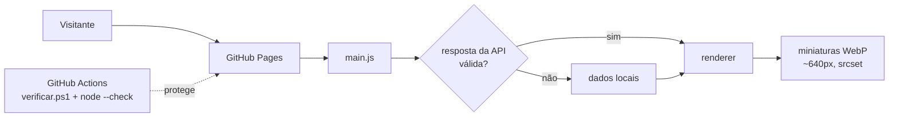

# 02 · Plano e arquitetura — tools

## 1. Arquitetura atual

```mermaid
flowchart LR
  V[Visitante] --> GP[GitHub Pages<br/>index.html + css + js]
  GP --> M[main.js]
  M --> D[data/tools.js<br/>data/host.js]
  M --> A[js/api.js]
  A -. desligada: placeholder em js/config.js .-> API[(learntech-content<br/>/v1/tools/*.json)]
  A -. desligado .-> SDK[sdk/identificacao.js]
  M --> R[js/renderer.js] --> U[js/utils.js]
  R --> DOM[Grade de cards<br/>filtros, busca, URL, tema]
  GP --> GF[Google Fonts]
  D --> FAV[google.com/s2/favicons<br/>4 miniaturas]
```

Fluxo: `main.js` tenta a API por até 2,5 s; se falhar, demorar ou (após o lote 1) devolver formato inesperado, usa os dados locais.

## 2. Arquitetura alvo (sem mudar o produto)



## 3. Decisões (ADR curto)

| ADR | Decisão | Motivo | Consequência |
| --- | --- | --- | --- |
| 001 | Manter site estático sem build | Readme declara "zero dependência"; publicação direta no Pages | Verificações em PowerShell/Node do próprio runner, sem `package.json` |
| 002 | Tratar dado da API como não confiável | API externa pode mudar ou ser comprometida | Validação de lista, `textContent` nos chips, `href` só http(s) |
| 003 | Um único script de verificação para dono e CI | Evita divergência entre local e CI | `docs/claudeia/verificar.ps1` roda no Windows e no `pwsh` do ubuntu-latest |
| 004 | Identificação do visitante é regra de negócio | Medição de acesso do ecossistema (inferido · confirmar) | Nunca remover; só aperfeiçoar (configuração, transparência, privacidade) |
| 005 | Não apagar órfãos nesta revisão | Regra da revisão | Órfãos ficam listados como aviso no verificar.ps1 |

## 4. Plano em lotes

| ID | Item | Motivo | Arquivos | Critério de pronto | Esforço | Risco | Muda o produto? | Situação |
| --- | --- | --- | --- | --- | --- | --- | --- | --- |
| L1-01 | Chips sem `innerHTML` | Categoria vinda da API não pode virar HTML | js/renderer.js | Chips idênticos visualmente; `<b>x</b>` como categoria aparece como texto | P | Baixo | Não | **Feito** |
| L1-02 | `href` só http(s) | Bloquear `javascript:` vindo de dado externo | js/renderer.js | 55 cards locais continuam linkando (todos https) | P | Baixo | Não | **Feito** |
| L1-03 | Validar resposta da API | Lista vazia ou malformada derrubaria a grade | main.js | Resposta inválida cai nos dados locais com `console.warn` | P | Baixo | Não (ver nota) | **Feito** |
| L1-04 | Script de verificação | Não havia teste algum | docs/claudeia/verificar.ps1 | Roda com 0 erro na raiz | P | Baixo | Não | **Feito** |
| L1-05 | CI | Não havia CI | .github/workflows/ci.yml | Workflow verde no GitHub | P | Baixo | Não | **Feito** (não executado ainda no GitHub) |
| L1-06 | Documentação da revisão | Entregável | docs/claudeia/*.md | Arquivos presentes | P | Nenhum | Não | **Feito** |
| L2-01 | Miniaturas em WebP ~640 px de largura | ~10 MB → estimativa < 1,5 MB | assets/thumb_*, data/*.js | Mesma aparência; peso medido antes/depois | M | Baixo | Não (visual igual) | Proposta |
| L2-02 | Logo em 64×64 (ou SVG) | 214 KB para 30 px | assets/logos, index.html | Mesma aparência | P | Baixo | Não | Proposta |
| L2-03 | Atualizar Readme (API, identificação, `js/api.js`, `js/config.js`) | Doc diverge do código | Readme.md | Seções "Externo" e "Estrutura" refletem o código | P | Nenhum | Não (texto do dono — revisar) | Proposta |
| L2-04 | Navegação por setas nas abas | Padrão ARIA de tablist | js/renderer.js | ←/→ alternam abas; Tab entra no painel | P | Baixo | Comportamento novo (pequeno) | Proposta |
| L2-05 | Outline visível no foco da busca | Foco só por cor de borda | css/header.css | Foco visível em ambos os temas | P | Baixo | Visual (pequeno) | Proposta — aprovar |
| L2-06 | `og:image`/`canonical`/`og:url` absolutos | Compartilhamento e SEO | index.html | Pré-visualização no LinkedIn/WhatsApp mostra imagem | P | Baixo | Não | Proposta (precisa da URL definitiva) |
| L2-07 | Mover órfãos (1,9 MB) | Peso do repositório | assets/ | verificar.ps1 sem aviso de órfão | P | Baixo | Não | Proposta (dono apaga) |
| L3-01 | Configurar `API_URL` e ativar identificação | Medição de acesso (regra de negócio) | js/config.js | Script `learntech-sdk` aparece no `<head>` em produção | P | Médio | **Sim** | Decisão de produto P-01 |
| L3-02 | Troca tardia de dados da API | Hoje API lenta é descartada | main.js | Dados da API substituem os locais sem perder filtro/URL | M | Médio | Sim | Decisão P-02 |
| L3-03 | Pré-renderizar catálogo no HTML | Indexação/sem JS | index.html (+ script gerador) | HTML servido contém os cards | G | Médio | Não visual | Decisão P-05 |
| L3-04 | Unificar título da aba | Coerência | index.html ou js/renderer.js | Um padrão só | P | Nenhum | Sim (texto) | Decisão P-03 |

Nota L1-03: uma lista **vazia** vinda da API agora é tratada como falha e o site mostra os dados locais. Se o dono quiser poder "esvaziar" o catálogo pela API, reverter essa parte (confirmar).
